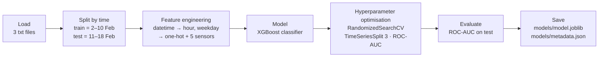

# occupancy-mlops

Case study: operationalise the Data Scientist's room-occupancy model. The model uses one-hot datetime features and an XGBoost classifier, is tuned with random search and is evaluated with ROC-AUC. The prediction says whether a room is occupied, so that heating, air conditioning and similar devices can be switched on or off.

## Tasks and where they are answered

| Task | Answer | Where |
|---|---|---|
| **1. Training pipeline:** sketch | Workflow diagram, with each step mapped to code | [Task 1: the training pipeline](#task-1-the-training-pipeline) below |
| **1. Training pipeline:** implementation | load → split by time → `Pipeline(datetime one-hot + sensors → XGBClassifier)` → `RandomizedSearchCV(TimeSeriesSplit(3), roc_auc)` → test ROC-AUC → `models/model.joblib` + `models/metadata.json` | `src/occupancy/data.py`, `features.py`, `train.py` |
| **2. Inference:** event-driven model endpoint | FastAPI `POST /events`: a sensor event goes in, the occupancy prediction comes out. The model is loaded once at start-up. `replay.py` is the event source: it sends each `datatest2.txt` row as an event | `src/occupancy/service.py`, `src/occupancy/replay.py` |
| **3. CI/CD:** build, test, push the training pipeline and the endpoint | `docker/Dockerfile.train`, `docker/Dockerfile.serve`. The pipeline runs pytest, builds both images, smoke-tests them (train image → endpoint image → `POST /events`) and pushes the tested images | `Scripts/ci_local.sh`, `.github/workflows/ci.yml` |
| **3. CT:** verbal description | How and when to retrain, where labels come from, promotion and rollout | [Continuous training](#continuous-training) below |

Tests are in `Scripts/tests/` and use only the real data files.

Further reading:
- [TASK3_TESTING.md](TASK3_TESTING.md): the Task 3 test procedure, step by step, with what each step checks and the results of the last run.
- [README_EXAMPLE.md](README_EXAMPLE.md): a worked, step-by-step test of the endpoint container, with the expected output of each step. It is also copied into the endpoint image at `/app/README_EXAMPLE.md`.

## Project layout

```
requirements.txt        pinned dependencies (the single list; pyproject.toml and the Dockerfiles use it)
pyproject.toml          the installable package `occupancy` (+ pytest as the [dev] extra)
Makefile                setup / train / test / serve / replay / ci-local
README_EXAMPLE.md       worked test of the endpoint container
TASK3_TESTING.md        Task 3 test procedure and results
data/raw/               the three provided UCI Occupancy files (read-only)
models/                 a trained model.joblib + metadata.json (make train regenerates them)
src/occupancy/          data.py · features.py · train.py (Task 1) · service.py · replay.py (Task 2)
docker/                 Dockerfile.train · Dockerfile.serve (Task 3)
Scripts/ci_local.sh     the CI/CD pipeline (Task 3)
.github/workflows/      ci.yml: runs the same pipeline on GitHub (Task 3)
Scripts/tests/          pytest tests
```

## Data

The data is the UCI Occupancy Detection dataset (Candanedo & Feldheim, 2016; UCI Machine Learning Repository, licensed CC BY 4.0), unchanged, in `data/raw/`, with one reading per minute, recorded 2–18 Feb 2015. Each row has `date`, Temperature (°C), Humidity (%), Light (lux), CO2 (ppm), HumidityRatio (kg water vapour / kg air) and the label Occupancy (0/1). See `data/raw/attribute_information.txt`.

- **Train:** `datatest.txt` and `datatraining.txt`, 2–10 Feb, 10,808 rows.
- **Test:** `datatest2.txt`, 11–18 Feb, 9,752 rows.

This is a split by time, so the model is always tested on days after the ones it learned from.

## Why the data and the model are in this repository, not in the images

The two Docker images contain **code only**. This repository holds everything else needed to replicate the results:

| What | Where | Used by |
|---|---|---|
| Code, Dockerfiles, tests, CI/CD | this repository | builds the images |
| Data, the three UCI files | `data/raw/` in this repository | mounted into `occupancy-train` (training) and `occupancy-serve` (replay) |
| Trained model | `models/` in this repository | mounted into `occupancy-serve` |
| Images | the container registry | `occupancy-train`, `occupancy-serve` |

The split is deliberate:

- **New data does not need a new image.** Continuous training retrains the same tested `occupancy-train` image on newer data. If the data were baked in, every retrain would need a rebuild, and the image would no longer stand for one version of the code.
- **A new or rolled-back model does not need a new image.** `occupancy-serve` loads whatever model is mounted at start-up, so changing the model is a file swap, not a rebuild and re-test.
- **It matches production.** There, data comes from storage such as a data lake and models from a model registry; neither is baked into the container. Here, `data/raw/` and `models/` stand in for those.
- **Each image is a pure function of its code version,** tagged with the git commit. Data and model versions are tracked separately, with `models/metadata.json` recording what each model scored.

**To replicate the results with the published images,** clone this repository, so you have `data/raw/` and `models/`, and run the Docker commands in "Run it: option C" with the image names from the registry. Retraining reproduces CV ROC-AUC 0.9931 and test ROC-AUC 0.9973. The included model gives `probability 0.9989364743232727` for the first test-week reading.

## Prerequisites

| For | You need |
|---|---|
| Tasks 1 and 2 (train, test, serve, replay) | Python **3.12** |
| The `make` shortcuts | `make` and [uv](https://docs.astral.sh/uv/). Without them, use the plain-Python commands below |
| Task 3 (`make ci-local`, or the images on their own) | Docker (Docker Desktop on macOS/Windows), `bash` and `curl`. On Windows use Git Bash or WSL |

A trained model is already in `models/`, so you can start the endpoint without training first.

## Run it: option A, with make + uv

```bash
make setup          # .venv (Python 3.12) + the pinned dependencies + the package
make train          # Task 1 -> models/model.joblib + models/metadata.json
make test           # pytest
make serve          # Task 2: endpoint on 127.0.0.1:8000
make replay         # Task 2, in a second terminal: send datatest2 rows as events (REPLAY_LIMIT=0 = all)
make ci-local       # Task 3: test -> build -> smoke-test -> push (only if PUSH_REGISTRY is set)
```

Settings are make variables, for example `make train N_ITER=20`, `make serve PORT=8080` or `make replay REPLAY_LIMIT=0`.

## Run it: option B, plain Python (no make, no uv)

macOS / Linux:

```bash
python3.12 -m venv .venv
source .venv/bin/activate
pip install -r requirements.txt          # pinned dependencies
pip install -e ".[dev]"                  # the occupancy package + pytest

python -m occupancy.train                # Task 1 (defaults: --data-dir data/raw --out models --n-iter 10)
python -m pytest                         # tests
uvicorn occupancy.service:app --port 8000          # Task 2: endpoint
python -m occupancy.replay --limit 100             # Task 2, in a second terminal (same venv)
```

Windows (PowerShell): create the venv with `py -3.12 -m venv .venv` and activate it with `.venv\Scripts\activate`. The other commands are the same.

To try the endpoint by hand while it is running:

```bash
curl -X POST localhost:8000/events -H 'Content-Type: application/json' -d \
 '{"event_id":"e-1","room_id":"room-1","reading":{"date":"2015-02-11 14:48:00","Temperature":21.76,"Humidity":31.13,"Light":437.33,"CO2":1029.67,"HumidityRatio":0.00502}}'
# -> {"event_id":"e-1","room_id":"room-1","probability":0.99...,"occupied":true}
```

Open http://localhost:8000 in a browser: it goes straight to the interactive API page (`/docs`), where you can try `POST /events`. `/events` only accepts POST, so typing it into the address bar gives 405.

## Run it: option C, Docker only (no Python on the host)

Run these from the project root:

```bash
docker build -f docker/Dockerfile.train -t occupancy-train .
docker build -f docker/Dockerfile.serve -t occupancy-serve .

# Task 1: run the training pipeline image (data and models are mounted)
docker run --rm -v "$PWD/data:/app/data:ro" -v "$PWD/models:/app/models" occupancy-train --n-iter 10

# Task 2: run the endpoint image on that model, then replay events into it
docker network create occupancy
docker run -d --rm --name serve --network occupancy -p 8000:8000 \
  -v "$PWD/models:/app/models:ro" occupancy-serve
docker run --rm --network occupancy -v "$PWD/data:/app/data:ro" -e OCC_DATA_DIR=/app/data/raw \
  occupancy-serve python -m occupancy.replay --url http://serve:8000 --limit 20
docker stop serve && docker network rm occupancy
```

## Task 1: the training pipeline

### Sketch



Steps C and D form one sklearn `Pipeline`. Step E tunes that whole pipeline.

| Step | Code |
|---|---|
| Load, split by time | `src/occupancy/data.py`: `load_data`, `load_train_test` |
| Feature engineering + model | `src/occupancy/features.py`: `DatetimeFeatures`, `build_pipeline` |
| Random search, evaluate, save | `src/occupancy/train.py`: `random_search`, `roc_auc`, `save`, `run`, `main` |

### Data Scientist's model definition → code

| Definition | Implementation |
|---|---|
| One-hot encoding of categorical features from datetime | `DatetimeFeatures` (timestamp → hour, day of week) → `OneHotEncoder` (hours 0–23, days 0–6), inside the pipeline |
| XGBoost Classifier | `XGBClassifier` as the last pipeline step |
| Random Search | `RandomizedSearchCV(n_iter=10, cv=TimeSeriesSplit(n_splits=3))` |
| ROC-AUC | `scoring="roc_auc"` in the search; ROC-AUC on the test file |

### Notes

- **Split by time.** The model trains on `datatest.txt` and `datatraining.txt` (2–10 Feb) and is tested on `datatest2.txt` (11–18 Feb). This way it is always tested on days after the ones it learned from.
- **Feature engineering sits inside the pipeline.** The saved model takes raw readings, so the endpoint (Task 2) has no feature code of its own.
- **3 time-series CV splits.** With 4 or 5 splits, one validation fold falls on a weekend with nobody in, and ROC-AUC is undefined.

## Task 3: the CI/CD pipeline

`Scripts/ci_local.sh` is the pipeline. It has four stages and stops at the first failure:

1. **Test:** `pytest`.
2. **Build:** `occupancy-train` and `occupancy-serve`, both tagged with the git SHA, or `local` outside a git checkout.
3. **Test the images:** the train image trains a model into a temporary folder. The serve image starts on that model, and one `POST /events` must return a prediction.
4. **Push:** the same images that passed stage 3 are tagged for `PUSH_REGISTRY` and pushed. Nothing is rebuilt. If `PUSH_REGISTRY` is not set, the push is skipped.

### Run the pipeline on your machine, including the push

Start Docker, then run a throwaway local registry. Host port 5001 is used here because macOS keeps port 5000 for AirPlay.

```bash
docker run -d --rm --name registry -p 5001:5000 registry:2
PUSH_REGISTRY=localhost:5001 make ci-local         # or: PUSH_REGISTRY=localhost:5001 bash Scripts/ci_local.sh
curl localhost:5001/v2/_catalog                    # -> {"repositories":["occupancy-serve","occupancy-train"]}
docker stop registry
```

Without make, run `bash Scripts/ci_local.sh` with the project venv active. The settings are environment variables, documented at the top of the script: `OCC_TAG`, `OCC_TRAIN_IMAGE`, `OCC_SERVE_IMAGE`, `N_ITER`, `CI_PORT` and `PUSH_REGISTRY`.

### Run the pipeline on GitHub

GitHub reads workflows only from `.github/workflows/` at the repository root. To use this folder as its own repository, push it to GitHub with this folder as the root. Then:

- **Every pull request and every push to `main`** runs the pipeline: test → build → smoke test.
- **Pushes to `main` also push the tested images** to GitHub Container Registry. They appear as `ghcr.io/<owner>/occupancy-train:<git-sha>` and `ghcr.io/<owner>/occupancy-serve:<git-sha>`. The workflow logs in with the built-in `GITHUB_TOKEN`, so no secret has to be set up.
- **New GHCR packages are private.** To let others pull them, make them public in the package settings. Pull with `docker pull ghcr.io/<owner>/occupancy-serve:<git-sha>`.

### Continuous training

| Question | Answer |
|---|---|
| **Why retrain?** | The model has seen one February week. Seasons change daylight, and Light is the strongest feature. Working patterns and sensor drift also change. Even within these files the inputs shift: mean Humidity goes from 25.6 % to 29.9 % and CO2 from 634 to 753 ppm between the training week and the test week |
| **When?** | (1) On a schedule (weekly). (2) When the input data drifts from the training data. (3) When ROC-AUC on newly labelled data drops |
| **Where do labels come from?** | Badge/access logs, motion sensors, room bookings, and manual AC overrides (a user switching the AC back on means the model was wrong) |
| **How?** | A scheduler or trigger re-runs the *same* tested `occupancy-train` image from the CI/CD pipeline on a newer data window. Data and models are mounted, so no new image is needed |
| **Is the new model better?** | Compare the new model with the current one by ROC-AUC on the *same* recent test window. Promote it only if it is at least as good |
| **Rollout?** | Run the new model in shadow first (it predicts but controls nothing), then on a few rooms, then on all. Roll back by pointing the endpoint back at the previous model folder |
| **CI/CD vs CT** | CI/CD reacts to *code* changes and produces tested images. CT reacts to *data* changes and produces tested models |

## Result

`make train`: CV ROC-AUC 0.9931, test ROC-AUC 0.9973.
